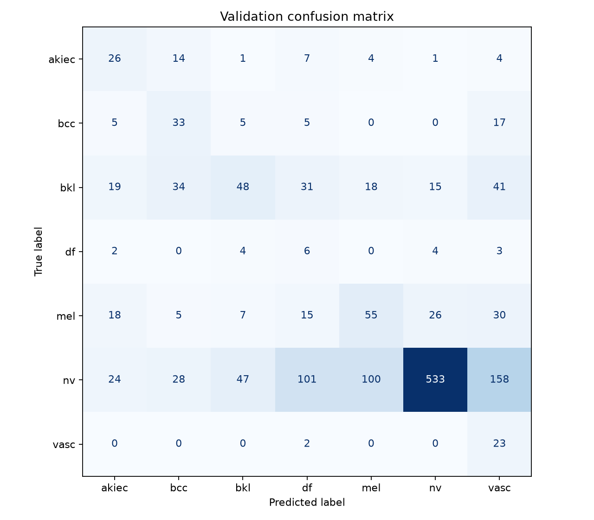

# Pixel Pathology — Intermediate

*ADSC Catalyst Project · Fall 2026*

## Overview

Pixel Pathology trains a neural network to spot disease in medical images — skin lesions, retinal scans, or chest X-rays — and then makes it show its work with Grad-CAM heatmaps that highlight exactly what it noticed. The final artifact isn't "cancer: yes/no" — it's "here's the exact patch the model found worrying."

## Objective

Fine-tune a modern CNN on a real medical-imaging dataset with proper transfer learning, and pair every prediction with an interpretable Grad-CAM overlay in a small demo app.

## Suggested tech stack

- **Data processing:** Python, OpenCV, Pillow
- **Modeling:** PyTorch (or TensorFlow) — CNN with transfer learning (ResNet50, EfficientNet-B0)
- **Interpretability:** Grad-CAM heatmap overlays
- **Visualization / demo:** Streamlit, Matplotlib
- **Data sources:** Kaggle (ISIC skin cancer, APTOS retinopathy, NIH ChestX-ray14)

See [`DATA.md`](DATA.md) for concrete data sources and how to access them.

## What team members will gain

- A model that diagnoses **and** explains itself — rare even in industry
- Transfer-learning skills that show up in every computer-vision job posting
- A project that could genuinely matter to someone's health

## Suggested scope (v1)

Pick **one** dataset. ISIC skin cancer or APTOS retinopathy are both smaller and more tractable than ChestX-ray14 for a semester timeline.

Build:

1. Data loader with proper class-balanced sampling and light augmentation,
2. Transfer-learn ResNet50 or EfficientNet-B0 with a two-stage training recipe (head-only, then fine-tune),
3. Robust evaluation: class-conditional accuracy, ROC/PR curves, calibration,
4. Grad-CAM overlays generated per prediction and displayed in a Streamlit upload demo,
5. A short evaluation writeup with failure-mode examples.

**Out of scope for v1:** clinical validation, multi-dataset transfer, segmentation (this is classification + attribution), federated learning.

**Important framing:** this is a learning project. It is **not** a diagnostic tool. Every artifact and the demo must be labeled as such.

See [`DELIVERABLES.md`](DELIVERABLES.md) for the suggested deliverable breakdown and rough timeline.

## Model and results

We use a **ResNet-50** pretrained on ImageNet (`IMAGENET1K_V2`). The backbone is frozen, and we train only a new seven-class output layer. HAM10000 is dominated by `nv` (about 67% of training images), so training uses **weighted sampling** to show the model each class about equally often. The final checkpoint is `weighted_sampling.pt`.

Results below are on the **validation split** (1,519 images). The test set stays untouched until final evaluation.

| | Macro F1 | Balanced accuracy |
|---|---:|---:|
| **Final model (weighted sampling)** | **0.320** | **47.5%** |
| Baseline (no imbalance handling) | 0.174 | 17.7% |

Per-class recall (the share of each class's images the model gets right):

| Class | Images | Final model | Baseline |
|---|---:|---:|---:|
| akiec: actinic keratoses / intraepithelial carcinoma | 57 | 45.6% | 0.0% |
| bcc: basal cell carcinoma | 65 | 50.8% | 3.1% |
| bkl: benign keratosis-like lesions | 206 | 23.3% | 14.1% |
| df: dermatofibroma | 19 | 31.6% | 0.0% |
| mel: melanoma | 156 | 35.3% | 8.3% |
| nv: melanocytic nevi | 991 | 53.8% | 98.5% |
| vasc: vascular lesions | 25 | 92.0% | 0.0% |

The baseline predicted almost everything as `nv`. Weighted sampling made the model recognize all seven classes but cost `nv` accuracy. The model now over-predicts the rare classes: most `df` and `vasc` predictions are wrong.

*Rows are true labels and columns are predicted labels.*

Full details, known weaknesses, and how to get the checkpoint: [`docs/model_card.md`](docs/model_card.md).

## Repository map

| File / folder | Purpose |
|---|---|
| [`CONTRIBUTING.md`](CONTRIBUTING.md) | **Start here.** How the team runs the project on GitHub — PM vs. member roles, the issue → PR → `main` flow, branching, worktrees, reviews. |
| [`DELIVERABLES.md`](DELIVERABLES.md) | Suggested deliverables and rough timeline. A living plan, not a contract. |
| [`DATA.md`](DATA.md) | Suggested data sources, how to access them, and the source register. |
| [`data/`](data/) | Local working folder for datasets. **Git-ignored** — data is never committed. |
| [`AGENTS.md`](AGENTS.md) | Machine-facing workflow rules for AI coding agents. |
| [`CODEOWNERS`](CODEOWNERS) | **Team roster + review policy.** PMs, members, and the code-owner rule for PRs into `main`. |

## Team

The current PMs and members for this project are listed in [`CODEOWNERS`](CODEOWNERS). PMs listed there are the code owners for PRs into `main`.
## Notes for PMs

This README, [`DELIVERABLES.md`](DELIVERABLES.md), and [`DATA.md`](DATA.md) are **suggestions**, not commitments. Rewrite them as the team scopes the real project.

## Notes for members

Read [`CONTRIBUTING.md`](CONTRIBUTING.md) before touching code. Then pick up an issue from the board.
