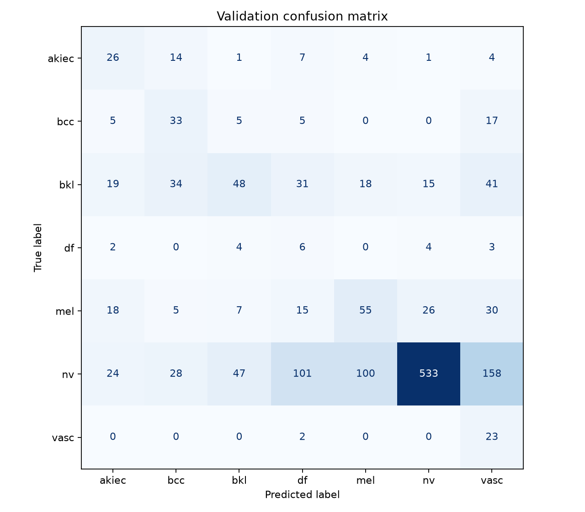

# Model card: Pixel Pathology skin-lesion classifier

Related issue: #83 (Week 6, Modeling & Experiments)

> **Educational use only.** This model is a learning project. It is not a diagnostic tool and must not be used for medical decisions.

## Summary

| | |
|---|---|
| Checkpoint | `weighted_sampling.pt` |
| Task | Classify one dermoscopic image into one of seven HAM10000 categories |
| Architecture | ResNet-50 with ImageNet `IMAGENET1K_V2` weights. The backbone is frozen, and only a new `Linear(2048, 7)` output layer is trained. |
| Output | Seven softmax probabilities in the order `akiec, bcc, bkl, df, mel, nv, vasc` (`CLASS_NAMES` in [`src/model.py`](../src/model.py)) |
| Validation macro F1 | **0.320** (baseline without weighted sampling: 0.174) |
| Test set | Not used. It stays held out until Week 7. |

## Intended use

- Show predictions and Grad-CAM heatmaps in the club's Streamlit demo.
- Teach transfer learning, class imbalance, and model evaluation.

**Out of scope:** clinical or self-diagnosis, screening real patients, and any image that isn't a dermoscopic skin-lesion photo.

## Data

- **Dataset:** HAM10000 (Harvard Dataverse, v4.0). See [`DATA.md`](../DATA.md).
- **Split:** 70/15/15 train/validation/test, grouped by `lesion_id` so no lesion appears in more than one split. Seed 42. See [`docs/week3/splits.md`](week3/splits.md).
- **Training images:** 7,002. **Validation images:** 1,519.
- The classes are very unbalanced: `nv` makes up about 67% of the training images, and `df` makes up about 1.3%.

## Training settings

| Setting | Value |
|---|---|
| Trainable parameters | Output layer only. BatchNorm layers stay in eval mode, so the frozen backbone's running statistics don't change. |
| Optimizer | SGD, learning rate 0.001 |
| Loss | Cross-entropy, unweighted |
| Batch size | 32 |
| Epochs | 10. The epoch with the lowest validation loss is saved. |
| Augmentation (training only) | Random resized crop to 224 (scale 0.8–1.0), horizontal flip, random rotation 0–180° |
| Prediction preprocessing | `ResNet50_Weights.IMAGENET1K_V2.transforms()`: resize to 232, center-crop to 224, ImageNet normalization |
| Device | Apple MPS |

Code: [`src/training.py`](../src/training.py), [`src/augmentation.py`](../src/augmentation.py), [`src/img_loader.py`](../src/img_loader.py).

## Imbalance handling

Training uses PyTorch's `WeightedRandomSampler`. Each image's weight is `1 / (number of training images in its class)`, and images are drawn with replacement. On average, each batch then has about equal numbers of each class. Validation uses no sampling or augmentation.

## Validation results

All 1,519 validation images, with the highest-probability class taken as the prediction. Source: [`docs/week4/weighted_sampling_metrics.json`](week4/weighted_sampling_metrics.json).

- Macro F1: **0.320**
- Balanced accuracy (mean per-class recall): 47.5%
- Overall accuracy: 47.7%

| Class | Images | Recall | Precision | Baseline recall |
|---|---:|---:|---:|---:|
| akiec | 57 | 45.6% | 27.7% | 0.0% |
| bcc | 65 | 50.8% | 28.9% | 3.1% |
| bkl | 206 | 23.3% | 42.9% | 14.1% |
| df | 19 | 31.6% | 3.6% | 0.0% |
| mel | 156 | 35.3% | 31.1% | 8.3% |
| nv | 991 | 53.8% | 92.1% | 98.5% |
| vasc | 25 | 92.0% | 8.3% | 0.0% |

Precision is computed from the saved confusion matrix. "Baseline" is the frozen-backbone model trained without weighted sampling, from [`docs/week4/weighted_sampling.md`](week4/weighted_sampling.md).

Rows are true labels and columns are predicted labels:



## Known weaknesses

- **`df` and `vasc` are over-predicted.** The model predicted `df` 167 times and was right only 6 times. It predicted `vasc` 276 times and was right 23 times. Most of these wrong predictions were `nv` images. A `df` or `vasc` prediction is usually wrong.
- **`nv` recall fell from 98.5% to 53.8%.** Weighted sampling traded common-class accuracy for rare-class recall. 458 of the 991 `nv` images went to other classes.
- **`bkl` has the lowest recall, at 23.3%.** Its errors spread across every other class, most often `vasc` (41), `bcc` (34) and `df` (31).
- **Rare-class numbers are noisy.** There are only 19 `df` and 25 `vasc` validation images, so one image changes recall by 4–5 points.
- **Frozen backbone.** Only the output layer learned from skin images. Fine-tuning deeper layers might help but wasn't part of this run.
- **Dataset limits.** The split groups by lesion, not by patient, so one patient's lesions could appear in both training and validation. HAM10000 comes from a small number of clinics and mostly lighter skin tones, so performance on other populations is unknown.
- **Probabilities are not calibrated.** Don't read a probability as the chance the lesion is that type.

## Getting the checkpoint

1. Download `weighted_sampling.pt` (about 95 MB) from the [Pixel Pathology Checkpoints](https://drive.google.com/drive/folders/1cHydYMl7UWaCWTJKq-wWhFXRHmJ_Jc8R?usp=sharing) Drive folder.
2. Save it as `models/weighted_sampling.pt`. The `models/` folder is git-ignored, so never commit checkpoints.
3. Check it on one image:

   ```bash
   python src/predict.py --checkpoint models/weighted_sampling.pt --image data/raw/HAM10000_images_part_1/ISIC_0024306.jpg
   ```

To retrain from scratch, generate `data/processed/splits.csv` first and run this command (results will differ slightly between runs):

```bash
python src/training.py --name weighted_sampling_reproduction.pt --num_epochs 10 --weighted_sampling
```

To re-evaluate on the validation split:

```bash
python src/evaluation.py --checkpoint models/weighted_sampling.pt --output-dir outputs/validation/weighted --device cpu
```
