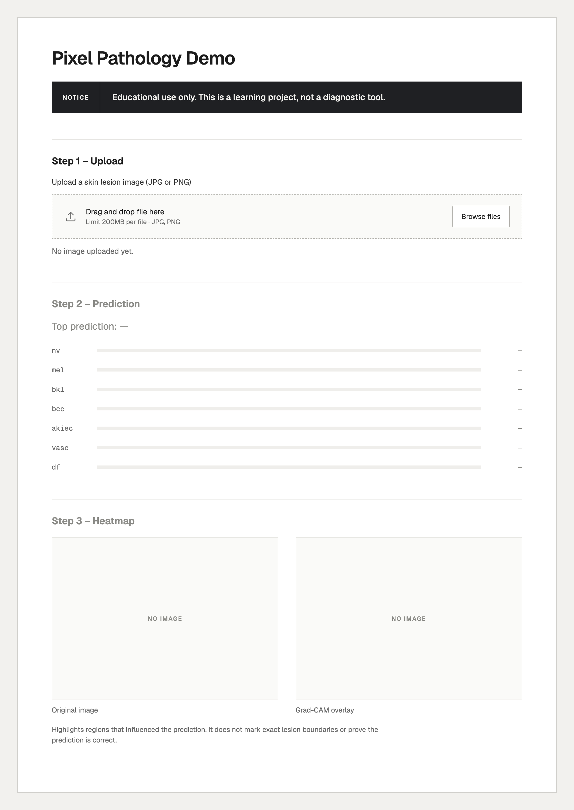
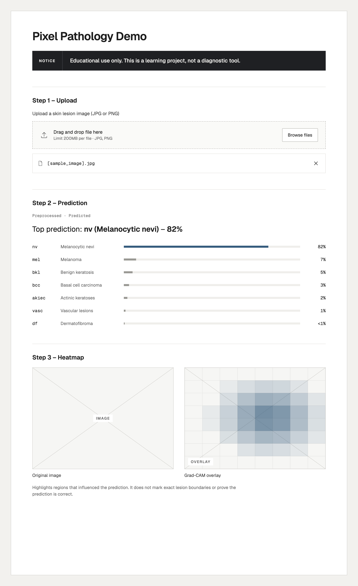

# Pixel Pathology — Demo Plan (Week 1)

Team: Explainability & Application

## 1. Interface sketch

The demo is a single-page Streamlit app with one vertical flow:

| Area | What it shows |
| --- | --- |
| Header | App title and the educational-use notice, visible before and after upload. |
| Upload | A single image uploader (JPG or PNG) with an empty-state message. |
| Prediction | The top predicted class with its confidence, plus a bar for each of the seven classes. |
| Heatmap | The original image and the Grad-CAM overlay side by side, with a short caption explaining what the overlay means. |

## 2. Planned flow

1. **Notice.** The user opens the app and sees the educational-use notice at the top of the page.
2. **Upload.** The user uploads one skin-lesion image. Until then, the prediction and heatmap areas show an empty-state message.
3. **Preprocess.** The app resizes and normalizes the image to match what the trained model expects.
4. **Predict.** The model returns a probability for each of the seven classes (`nv`, `mel`, `bkl`, `bcc`, `akiec`, `vasc`, `df`).
5. **Show prediction.** The app shows the top class, its confidence, and a bar for every class.
6. **Heatmap.** The app computes Grad-CAM for the predicted class and shows the original image and the overlay side by side, with a caption that the overlay does not mark exact lesion boundaries or prove the prediction is correct.
7. **Repeat.** Uploading a new image resets steps 3–6.

Not handled yet (open questions): what the app shows for a non-image or unreadable file, and whether low-confidence predictions get an extra warning.

## 3. Grad-CAM explanation

Grad-CAM is a method that helps show us which parts of an image a neural network paid attention to when it made a prediction. It looks at the last convolutional layer and uses gradients to measure how much each feature map contributed. It combines those feature maps into a single heatmap and overlays it on the original. Warmer colors means that they contributed more to the prediction while, cooler colors means those regions contributed less.

Putting it in context to this project it means that after a user uploads an image and the model predicts one of the seven classes, we will show the heatmap next to the prediction so users can see which regions influenced it. Grad-CAM will highlight the regions that contributed to the prediction. 

## 4. Grad-CAM limitations

Limitation #1
Grad Cams highlight only parts or fragments of an object rather than outlining its entire shape. This happens because the averaging of pixel gradients can dilute contributions from feature maps with smaller spatial footprints.

[Source]https://www.alphaxiv.org/abs/1710.11063

Limitation #2
When one image has multiple occurences of a class or distinct objects Grad-CAM will not be able to identify all of them accurately because it often focuses on just one instance

[Source]https://www.alphaxiv.org/abs/1710.11063

## 5. What the app needs from other teams

### From Data & Analysis (Issue 4)
* **Preprocessing Values & Pipeline:** Think of these as the numerical values related to pre-processing. Main ones include image resolution, any mean/sd normalization values, and maybe color channel expectations (likely RGB).
* **Class Mapping & Order:** Explicit index-to-label mapping for all 7 of the HAM10000 classes (e.g., `0: 'akiec'`, `1: 'bcc'`, `2: 'bkl'`, `3: 'df'`, `4: 'mel'`, `5: 'nv'`, `6: 'vasc'`) along w/ full clinical display names for UI elements.
* **Sample Test Images:** A set of 5–10 representative, git-ignored validation images covering different lesion types for testing the app UI.

### From Modeling & Experiments (Issue 5)
* **Trained Model Weights:** Exported model artifact (`.pth` or `.pt` PyTorch file) trained on HAM10000.
* **Model Architecture & Target Layer Name:** Exact PyTorch model definition or setup script, including the target convolutional layer (e.g., `model.layer4[-1]`) required for hooking Grad-CAM gradients.
* **Evaluation Context:** Guidance on any confidence thresholds or warning metrics to display if predictions fall below a certainty baseline. This serves to make the output more human-friendly. 

---

## 6. Educational-use notice

> **Disclaimer & Educational Notice**
> 
> **FOR EDUCATIONAL AND DEMONSTRATION PURPOSES ONLY.**
> 
> This web application is a student learning project created for the Aggie Data Science Club (ADSC). It is **not** a clinical diagnostic tool, medical device, or replacement for professional medical advice, diagnosis, or treatment. Do **not** use this as replacement for a medical professional, and always seek the advice of a qualified dermatologist with any questions regarding skin conditions or lesions.

## Sources

<!-- Add links used for any section above. -->
https://claude.com/product/design

## Contributions and reflections

<!-- Each member: what you contributed and a brief reflection. -->
Evan: created the demo sketch and explained the app flow
Abhi: finished the educational-use notice & what we need from other issues/teams