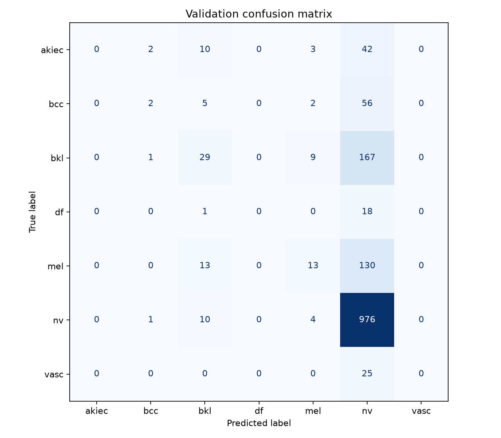

# Week 3: Validation evaluation

Contributor: Rahul Bathala — Issue #41, task 6.

## Method

Evaluated Harrit's baseline_model.pt on all 1,519 validation images
using the shared ResNet50 IMAGENET1K_V2 preprocessing, without random
augmentation. Test images were not evaluated.

Predictions use the highest-scoring class. Macro F1 is calculated over
the entire validation set with equal weight for all seven classes and
zero_division=0.

Class order: akiec, bcc, bkl, df, mel, nv, vasc.

## Results

- Validation macro F1: 0.23914343827718973.
- Validation images: 1,519.
- Device: Apple MPS.
- Batch size: 16; shuffle=False; drop_last=False.

The model predicted only bkl, mel, and nv. It correctly classified
35 of 156 melanoma images and 947 of 991 nv images. It never predicted
akiec, bcc, df, or vasc. The cause of this uneven performance needs
investigation in the training work.

Checkpoint supplied by Harrit. Training settings and checkpoint
selection details belong with the training documentation.

Full results: [validation_metrics.json](validation_metrics.json).

Matrix rows are true labels; columns are predicted labels.

## Usage

Requires torch, torchvision, pandas, Pillow, scikit-learn, numpy,
and matplotlib.

Import evaluate_validation and save_validation_results from
src.evaluation. Call evaluate_validation(model, validation_loader,
device), then pass its returned dictionary and an output directory
to save_validation_results.

The loader must use the confirmed validation split, shared prediction
preprocessing, no sampling with replacement, and drop_last=False.
Load the checkpoint with strict=True using the agreed class order.

Obtain baseline_model.pt from Harrit. Keep checkpoints, images, and
generated manifests out of GitHub.

## Verification

A synthetic eight-image check verified the expected macro F1,
confusion-matrix counts, aggregation across unequal batches,
model-mode restoration, and JSON/PNG creation. Its score of 0.904762
is a synthetic code check, not model performance.

Real-image evaluation then completed on all 1,519 validation images.

## Contribution and next step

I implemented and tested the validation evaluator and recorded results
for the team's baseline checkpoint. I learned how macro F1 and the
confusion matrix expose classes the model fails to recognize. My
remaining question is whether the agreed imbalance approach improves
recognition of the rarer classes.

For Week 4, reuse this evaluator to compare the fine-tuned model
against this baseline on the same validation split. This depends
on the team's next trained checkpoint.

## Unified split-file verification — October 28

Generated data/processed/splits.csv using Data's create_splits.py
from issue-40/integration with seed 42. Verified unique image IDs,
no lesions shared across splits, and an exact match between all
1,519 validation image IDs, lesion IDs, and labels and the earlier
validation manifest.

Used SkinLesionDataset with splits_path="data/processed/splits.csv"
and split="val". A real-image batch loaded with shape (16, 3, 224, 224)
and labels of shape (16,).

Reevaluated the original baseline_model.pt using the unified loader.
Macro F1 remained 0.23914343827718973, and the confusion matrix and
class order matched the original saved results exactly. No weighted
sampling or random augmentation was used for validation.

This verifies the evaluation path with the unified split file.
It does not verify the corrected training run or prediction interface.
