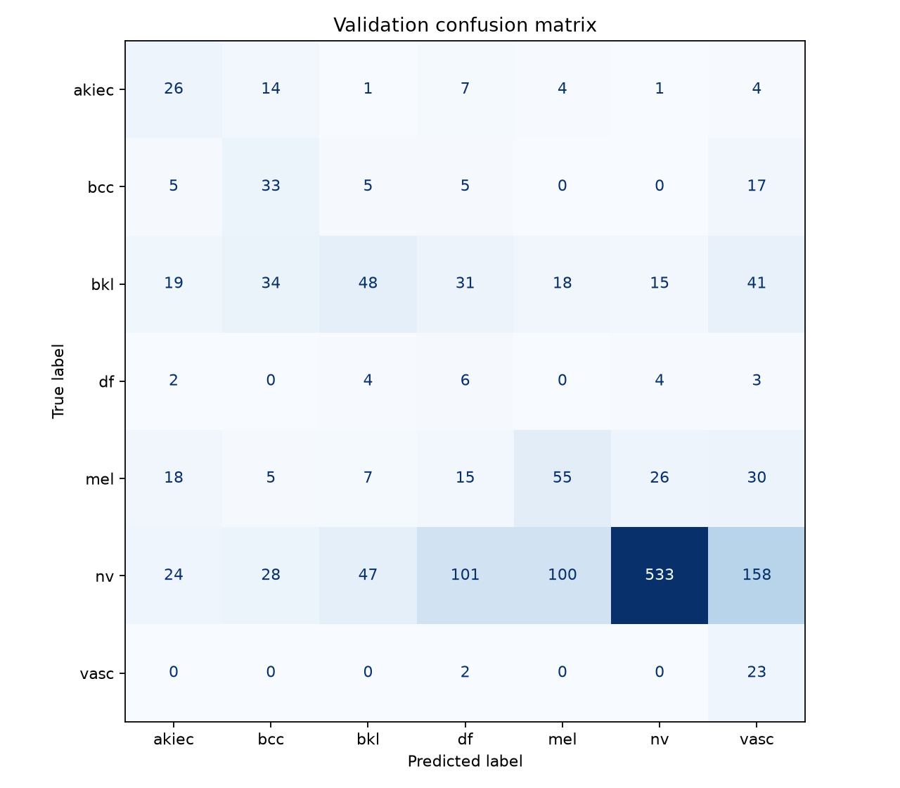
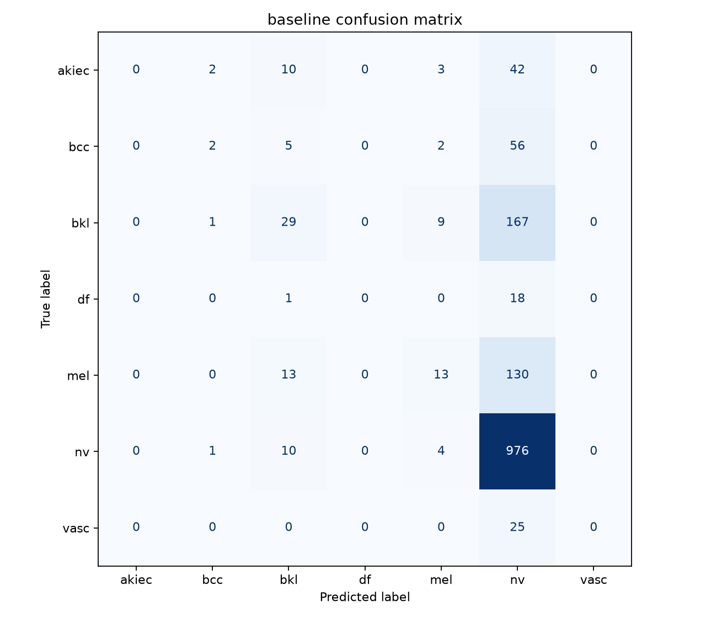

# Week 4: Weighted Sampling Evaluation

Contributors:
- Eric: Issue 62 - Task 1, 2
- Harrison: Issue 62 - Task 3, 4
- Rahul: Issue 62 - Task 3

## Method

Evaluated weighted_sampling.pt on all 1,519 validation images
using the shared ResNet50 IMAGENET1K_V2 preprocessing, without random
augmentation. Test images were not evaluated. (Model was trained for 10 epochs)

Predictions use the highest-scoring class. Macro F1 is calculated over
the entire validation set with equal weight for all seven classes and
zero_division=0.

Class order: akiec, bcc, bkl, df, mel, nv, vasc.

## Results

After weighted sampling, the classification of nv worsened while the other six lesion classes saw improvement. 23 of the 25 vasc lesions were correctly classified, while the other lesions saw more distribution in their respective rows. This is a good improvement compared to the classes the corrected baseline never predicted (akiec, df, vasc). The F1 score also saw an improvement of ~0.146. However, after using weighted sampling, the classification of nv dropped from 976 to 533 of 991 images. 

### weighted sampling

- Validation macro F1: 0.32023200121813994.
- Validation images: 1,519.
- Device: Apple MPS.
- Batch size: 16; shuffle=False; drop_last=False.


### baseline

- Validation macro F1: 0.1740995292976135.
- Validation images: 1,519.
- Device: Apple MPS.
- Batch size: 16; shuffle=False; drop_last=False.


Full results: [weighted_sampling_metrics.json](weighted_sampling_metrics.json).

Full results for baseline can be found under Week 3 documentation.

### Confusion Matrices for weighted sampling and baseline: <br>
The confusion matrix for the weighted sampling shows a slight trend towards the diagonal, implying improvements in classification.





## Validation Error Examples

Based on the weighted sampling confusion matrix, we are able to clearly identify common trends of misclassification errors the model makes. The largest sources of validation errors include:

- nv being misclassified as vasc, mel, df

- bkl being misclassified as vasc, bcc

- bcc being misclassified as vasc

## Per-class validation recall

Both checkpoints were evaluated on the same 1,519 validation images.
Recall is correct predictions divided by the number of images of that class.

| Class | BatchNorm-fixed baseline | Weighted sampling |
| --- | ---: | ---: |
| akiec | 0/57 (0.0%) | 26/57 (45.6%) |
| bcc | 2/65 (3.1%) | 33/65 (50.8%) |
| bkl | 29/206 (14.1%) | 48/206 (23.3%) |
| df | 0/19 (0.0%) | 6/19 (31.6%) |
| mel | 13/156 (8.3%) | 55/156 (35.3%) |
| nv | 976/991 (98.5%) | 533/991 (53.8%) |
| vasc | 0/25 (0.0%) | 23/25 (92.0%) |

## Commands

From the repository root, set up the HAM10000 image folders and
`data/processed/splits.csv`. To train a weighted checkpoint:

```bash
python src/training.py --name weighted_sampling_reproduction.pt --num_epochs 10 --weighted_sampling
```

To evaluate the exact saved checkpoints used in this report, place them
in `models/` and run:

```bash
python src/evaluation.py --checkpoint models/baseline_resnet50.pt --output-dir outputs/validation/baseline --device mps
python src/evaluation.py --checkpoint models/weighted_sampling.pt --output-dir outputs/validation/weighted --device mps
```

Use `--device cpu` if MPS is unavailable. The CLI reads only validation
rows and saves metrics and a confusion matrix separately for each run.

## App handoff

Recommend the evaluated `weighted_sampling.pt` for the educational demo:
macro F1 was 0.3202 versus 0.1741, with higher recall in six of seven
classes and lower recall for `nv`. Obtain the exact file from Modeling
or the [shared checkpoint folder](https://drive.google.com/drive/folders/1cHydYMl7UWaCWTJKq-wWhFXRHmJ_Jc8R?usp=sharing).
Pass `models/weighted_sampling.pt` explicitly to the app's `load_model` call.
To check that it returns seven probabilities on a local image:

```bash
python src/predict.py --checkpoint models/weighted_sampling.pt --image data/raw/HAM10000_images_part_1/ISIC_0024306.jpg
```

Keep checkpoint files outside Git.
