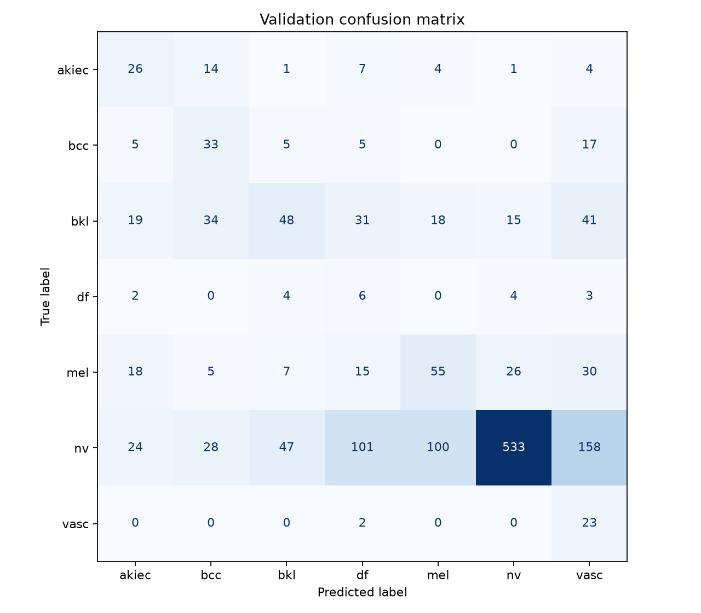
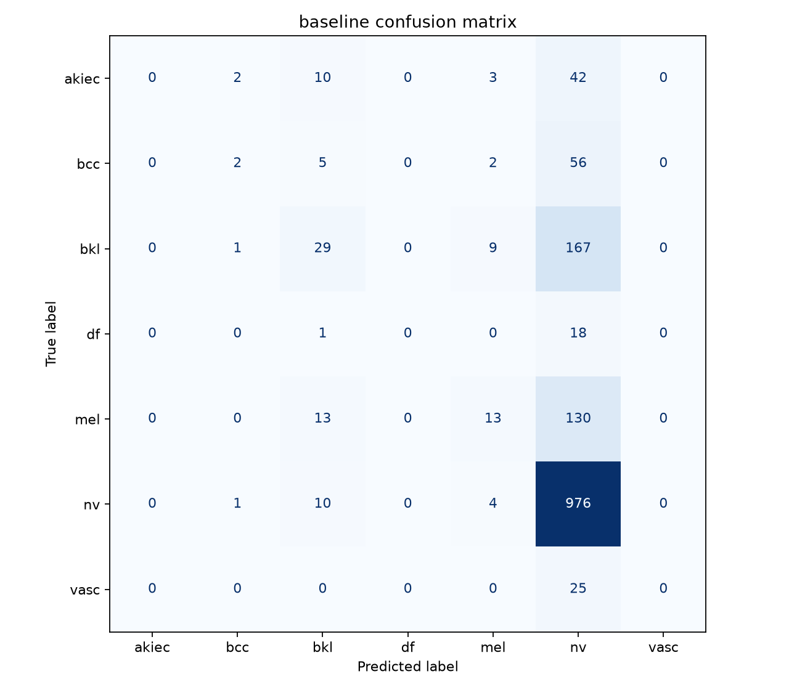

# Week 4: Weighted Sampling Evaluation

Contributors:
- Eric: Issue 62 - Task 1, 2
- Harrison: Issue 62 - Task 3, 4

## Method

Evaluated weighted_sampling.pt on all 1,519 validation images
using the shared ResNet50 IMAGENET1K_V2 preprocessing, without random
augmentation. Test images were not evaluated. (Model was trained for 10 epochs)

Predictions use the highest-scoring class. Macro F1 is calculated over
the entire validation set with equal weight for all seven classes and
zero_division=0.

Class order: akiec, bcc, bkl, df, mel, nv, vasc.

## Results

After weighted sampling, the classification of nv worsened while the other six lesion classes saw improvement. 23 of the 25 vasc lesions were correctly classified, while the other lesions saw more distribution in their respective rows. This is a good improvement compared to the classes the corrected baseline never predicted (akiec, bcc, bkl, df, mel, vasc). The F1 score also saw an improvement of ~0.146. 

### weighted sampling

- Validation macro F1: 0.32023200121813994.
- Validation images: 1,519.
- Device: Apple MPS.
- Batch size: 16; shuffle=False; drop_last=False.

### baseline

- Validation macro F1: 0.1740995292976135.
- Validation images: 1,519.
- Device: Apple MPS.
- Batch size: 16; shuffle=False; drop_last=False.

Full results: [weighted_sampling_metrics.json](weighted_sampling_metrics.json).

Full results for baseline can be found under Week 3 documentation.

### Confusion Matrices for weighted sampling and baseline:  
The confusion matrix for the weighted sampling shows a slight trend towards the diagonal, implying improvements in classification.

## Validation Error Examples

Based on the weighted sampling confusion matrix, we are able to clearly identify common trends of misclassification errors the model makes. The largest sources of validation errors include:

- nv being misclassified as vasc, mel, df

- bkl being misclassified as vasc, bcc

- bcc being misclassified as vasc

Images:
