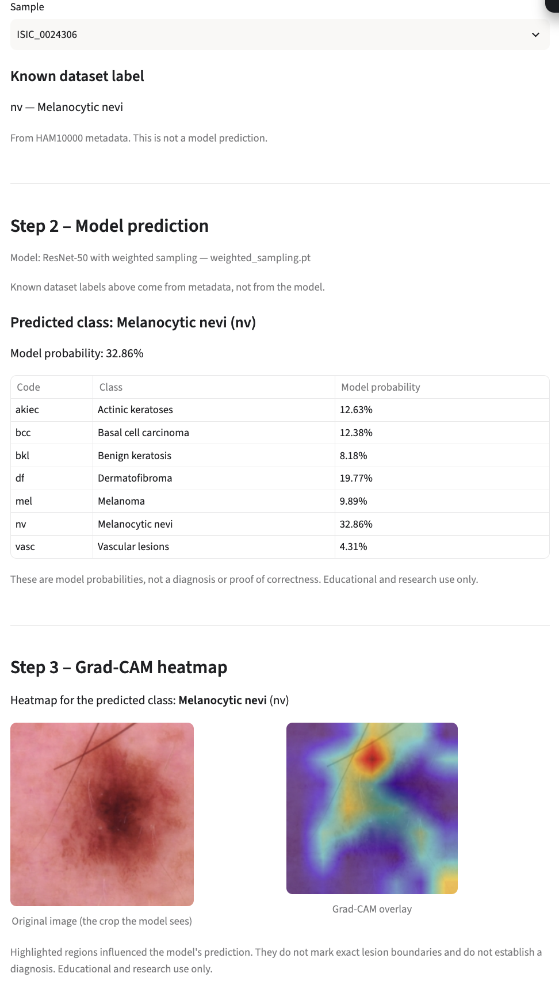
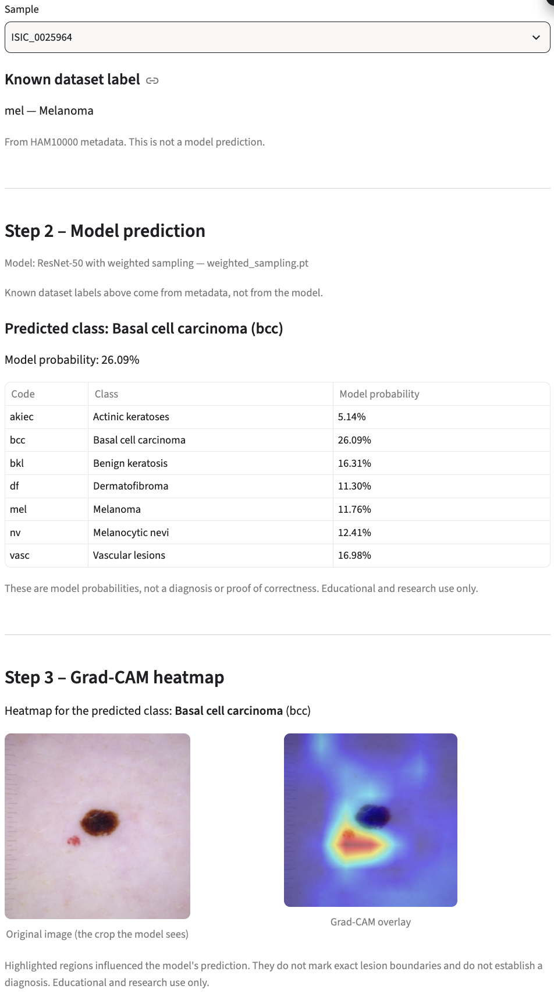
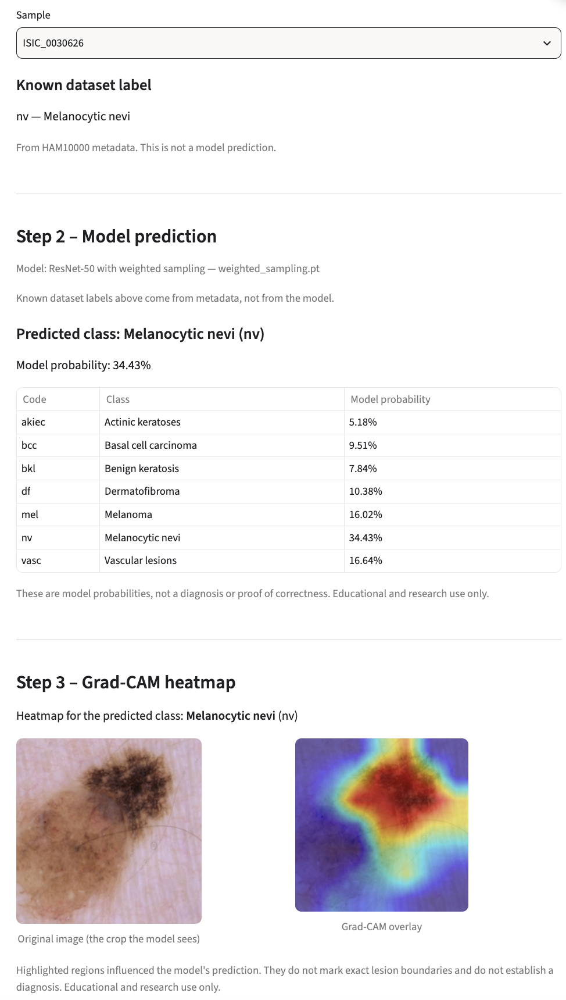

# Grad-CAM examples

Model: ResNet-50 with weighted sampling (`weighted_sampling.pt`), the Week 6 demo checkpoint. Each screenshot shows the known dataset label, the model's prediction with all seven probabilities, and the Grad-CAM overlay for the predicted class. Images are HAM10000 samples.

These are three single images chosen to illustrate the heatmaps. They are not an evaluation of the model.

## Example 1: ISIC_0024306 (known nv, predicted nv, 32.86%)

Correct prediction, but low confidence: the next highest is df at 19.77%. The strongest highlight appears near a hair strand at the edge of the lesion, while the darkest part of the lesion is only lightly highlighted.

## Example 2: ISIC_0025964 (known mel, predicted bcc, 26.09%)

Incorrect prediction. The known label, mel, received only 11.76%, and the probabilities are spread across several classes. The highlight sits on a small red spot beside the lesion, while the dark lesion itself is barely highlighted.

## Example 3: ISIC_0030626 (known nv, predicted nv, 34.43%)

Correct prediction, but low confidence: the next highest are vasc (16.64%) and mel (16.02%). Here the highlight covers the dark core of the lesion and extends into the surrounding skin.

## What the heatmaps do and don't show

- They show regions that influenced the model's score for the predicted class.
- They do not mark exact lesion boundaries, show that the model looked at the right feature, or show that the prediction is correct.
- Example 2 is a wrong prediction whose highlight lands beside the lesion. Example 3's highlight overlaps the lesion, yet the model is still only 34% confident. Where the heatmap lands and whether the prediction is correct are separate questions.

Educational and demonstration use only. This is not a diagnostic tool.
