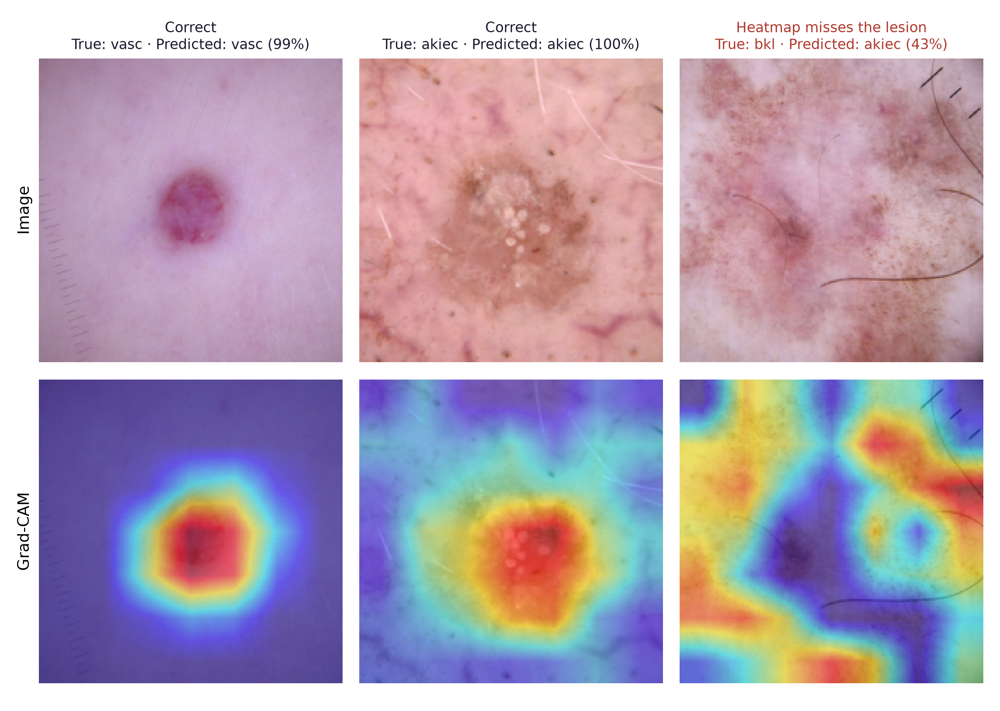
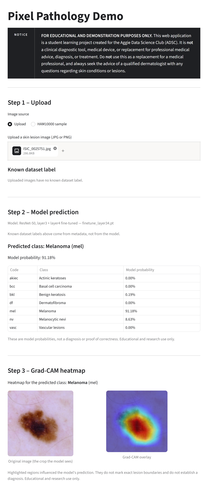

# App poster figures (#95)

Model: **`finetune_layer34.pt`**, the final model ([release](https://github.com/TAMU-Aggie-Data-Science-Club/fall2026-pixel-pathology/releases/tag/model-finetune-layer34-v1), [`final_model.md`](final_model.md)). Both figures are 300 DPI PNGs on white, in [`figures/`](figures/). Images are HAM10000 validation-split images.

## Grad-CAM examples: `figures/gradcam_heatmap_miss.png`



**Caption:** Grad-CAM from the final model: the heatmap covers the lesion in two correct predictions but misses it in a third, which the model also gets wrong.

| Panel | Image | Known label | Prediction | What the heatmap shows |
|---|---|---|---|---|
| 1 | ISIC_0031217 | vasc | vasc (98.9%) | Centered on the lesion. |
| 2 | ISIC_0025331 | akiec | akiec (99.8%) | Centered on the lesion. |
| 3 | ISIC_0027388 | bkl | akiec (43.2%) | The lesion's dark center is the coldest area. The strongest highlights are on the ruler marks and hair at the upper right and along the image edges. |

How the images were picked: Grad-CAM was run on all 1,519 validation images, ranked by how far the heatmap peak sat from a rough dark-region lesion mask, and the candidates were checked by eye. The three panels illustrate the heatmaps. They are not an evaluation of the model.

Regenerate (needs the checkpoint in `models/` and `data/processed/splits.csv`):

```bash
python src/gradcam_figure.py \
    --panel ISIC_0031217 "Correct" \
    --panel ISIC_0025331 "Correct" \
    --panel ISIC_0027388 "Heatmap misses the lesion"
```

## Full app flow: `figures/app_full_flow.png`



**Caption:** The demo's full flow: upload a lesion image, get the model's probabilities for all seven classes, and see the Grad-CAM heatmap for the predicted class.

The screenshot uploads ISIC_0025751 (known label mel, predicted mel at 91.18%) to the app running locally with `finetune_layer34.pt`. It covers Steps 1–3; the confusion-matrix section below them is not shown.

Educational and demonstration use only. This is not a diagnostic tool.
